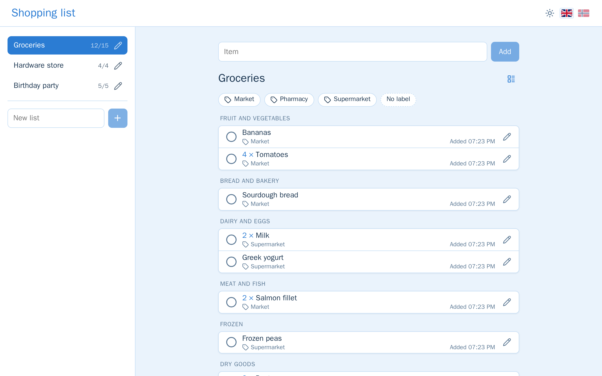
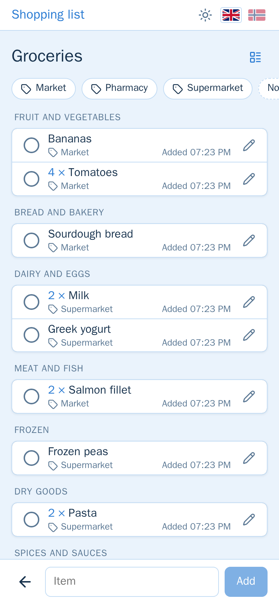
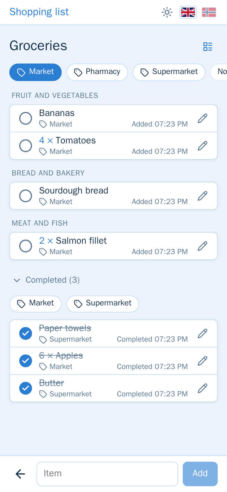
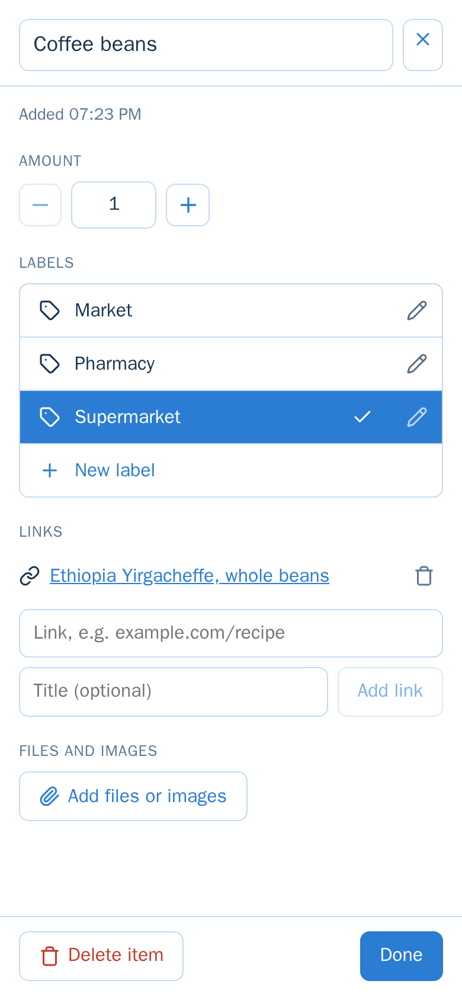
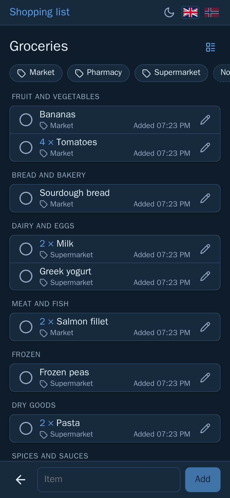

<div align="center">

# 🛒 Shopping list

**Shared shopping lists for the whole household, right in the Home Assistant sidebar.**

Items are sorted into store sections by a small on-device language model, filtered by shop,
and show up in Home Assistant as to-do lists, sensors and automation events.

[](https://github.com/EirikGG/shopping-list/releases)
[](https://github.com/EirikGG/shopping-list/actions/workflows/addon.yml)

[](https://hacs.xyz/docs/faq/custom_repositories/)




</div>

## Contents

- [Features](#features)
- [Screenshots](#screenshots)
- [Installation](#installation)
- [Home Assistant integration](#home-assistant-integration)
- [Data, privacy and backups](#data-privacy-and-backups)
- [How it is built](#how-it-is-built)
- [Development](#development)
- [Releasing](#releasing)

## Features

- **Shared by the household.** Every Home Assistant user sees and edits every list. There are no
  separate accounts: Home Assistant logs you in, and the add-on records who added what.
- **Sorted by store section.** Items are put under Fruit and vegetables, Dairy and eggs, Frozen,
  Household and so on, in the order a shop usually has them. A small multilingual language model
  ([multilingual-e5-small](https://huggingface.co/intfloat/multilingual-e5-small)) does this on the
  device, in English and Norwegian. Sections can be turned off for lists that aren't for shopping.
- **Labels and filters.** Tag items with the shop you'll buy them in, then filter the list to that
  shop when you're there. The filter only offers labels on items still to buy, and completed items
  have a filter of their own.
- **Amounts, links, files and photos.** `2 × Milk`, a link to the product, a photo of the right
  brand, or a receipt.
- **Built for phones.** Works in the Home Assistant Companion app. Swipe to delete, and a ticked
  item stays in place for a moment so a mistaken tap can be undone.
- **Light and dark theme, English and Norwegian.**
- **Part of Home Assistant.** Lists become to-do lists (for Assist and the phone widget), sensors,
  and events you can build automations on. See [Home Assistant integration](#home-assistant-integration).

## Screenshots

<table>
  <tr>
    <td align="center"></td>
    <td align="center"></td>
    <td align="center"></td>
    <td align="center"></td>
  </tr>
  <tr>
    <td align="center"><sub>Sorted into store sections</sub></td>
    <td align="center"><sub>Filtered to one shop</sub></td>
    <td align="center"><sub>Amount, labels, links and files</sub></td>
    <td align="center"><sub>Dark theme</sub></td>
  </tr>
</table>

## Installation

Requires Home Assistant OS or a Supervised installation (for add-ons), on **amd64** or **aarch64**
(e.g. a Raspberry Pi 4/5 with a 64-bit OS).

### 1. The add-on

[](https://my.home-assistant.io/redirect/supervisor_add_addon_repository/?repository_url=https%3A%2F%2Fgithub.com%2FEirikGG%2Fshopping-list)

Or by hand:

1. In Home Assistant, go to **Settings → Add-ons → Add-on store**, open the **⋮** menu and choose
   **Repositories**.
2. Add `https://github.com/EirikGG/shopping-list`.
3. Find **Shopping list** in the store, install it, and start it.

Shopping list then appears in the sidebar for every user. The sorting model takes up to a minute
to load the first time the add-on starts. Until then, new items are sorted when it's ready.

### 2. To-do lists in Home Assistant (optional)

This needs an MQTT broker, such as the **Mosquitto broker** add-on with the MQTT integration set up.

[](https://my.home-assistant.io/redirect/hacs_repository/?owner=EirikGG&repository=shopping-list&category=integration)

Or by hand:

1. In HACS, open the **⋮** menu → **Custom repositories**, and add
   `https://github.com/EirikGG/shopping-list` with the type **Integration**.
2. Download **Shopping list (add-on)**, and restart Home Assistant.
3. Go to **Settings → Devices & services → Add integration**, and choose **Shopping list (add-on)**.
   There's nothing to fill in.

## Home Assistant integration

With an MQTT broker, the add-on finds it by itself and every list becomes a device with:

| Entity | What it does |
| --- | --- |
| **Open items** (sensor) | How many items are left, with the items, amounts and labels as attributes. |
| **Changes** (event) | Fires on `item_added`, `item_completed`, `item_reopened`, `item_changed` and `item_deleted`, including who made the change. |
| **Add item** (text) | Whatever you type in it is added to the list. |

With the HACS integration, every list is also a `todo.` entity. You can use it from:

- the **To-do lists** page in Home Assistant,
- **Assist**: *"Add milk to Groceries"*,
- the Companion app's **To-do List widget** on your phone's home screen.

Lists can be changed from automations by publishing to MQTT:

```yaml
actions:
  - action: mqtt.publish
    data:
      topic: shopping_list/list/1/command
      payload: '{"action": "add", "name": "Milk", "amount": 2, "labels": ["Supermarket"]}'
```

Or you can be notified when someone adds something:

```yaml
triggers:
  - trigger: state
    entity_id: event.groceries_changes
    not_from: [unavailable, unknown]
conditions:
  - condition: state
    entity_id: event.groceries_changes
    attribute: event_type
    state: item_added
actions:
  - action: notify.mobile_app_phone
    data:
      message: "{{ trigger.to_state.attributes.by }} added {{ trigger.to_state.attributes.item }}"
```

The add-on's **Documentation** tab ([`shopping_list/DOCS.md`](shopping_list/DOCS.md)) has every
command, event attribute and option.

## Data, privacy and backups

- **Everything stays local.** No cloud service and no telemetry. The language model runs inside the
  add-on.
- **Only reachable through Home Assistant.** The add-on publishes no ports and only accepts requests
  from Home Assistant's own ingress proxy.
- **Included in backups.** Lists are kept in one SQLite database, and files and photos sit next to it
  in the add-on's data folder. Both are part of every Home Assistant backup. The add-on is paused for
  a few seconds during a backup, so the copy is consistent.
- Files and photos can be up to 15 MB each, the most Home Assistant's ingress accepts.

## How it is built

```
shopping-list/
├── repository.yaml                  Makes this repository a Home Assistant add-on repository
├── hacs.json                        Makes it a HACS repository for the integration
├── shopping_list/                   The add-on
│   ├── config.yaml                  Add-on manifest (version, ingress, MQTT, backups)
│   ├── Dockerfile                   Builds the backend, the frontend and fetches the model
│   ├── DOCS.md / CHANGELOG.md       Shown in the add-on's Documentation and Changelog tabs
│   ├── rest/                        Backend: Java 21, Javalin, SQLite, ONNX Runtime
│   └── web/                         Frontend: Vue 3, Vite
└── custom_components/
    └── shopping_list_addon/         HACS integration: lists as to-do entities, over MQTT
```

| Part | Technology |
| --- | --- |
| Backend | Java 21, Javalin, SQLite with Liquibase migrations, Maven |
| Store sections | multilingual-e5-small (int8 ONNX) via ONNX Runtime, with a tokenizer written in Java |
| Frontend | Vue 3, vue-i18n, VueUse, Vite |
| Home Assistant | Ingress add-on, MQTT discovery, a custom integration for to-do entities |
| CI/CD | GitHub Actions builds amd64 and aarch64 images to the GitHub container registry |

## Development

The local stack runs in Docker. The Vite dev server stands in for Home Assistant: it forwards `/api`
to the backend as a made-up Home Assistant user, and reloads when the source changes.

```sh
cp .env.example .env
docker compose -p shopping-list-dev --profile dev up -d --build
```

Then open `http://localhost` (or the `WEB_PORT` in `.env`).

## Releasing

GitHub Actions ([`.github/workflows/addon.yml`](.github/workflows/addon.yml)) tests every push and pull
request. On `main` it also builds the add-on for amd64 and aarch64, publishes the images to the
GitHub container registry, where Home Assistant downloads them, and makes a GitHub release
`v<version>`, which HACS installs the integration from.

A version is only published once. To release:

1. Bump `version` in `shopping_list/config.yaml` and
   `custom_components/shopping_list_addon/manifest.json` (the workflow checks that they match), and
   add it to `shopping_list/CHANGELOG.md`.
2. Push to `main`, and wait for the workflow to finish (a few minutes) before updating in Home
   Assistant. Until then Home Assistant may offer the update but fail to download it.
